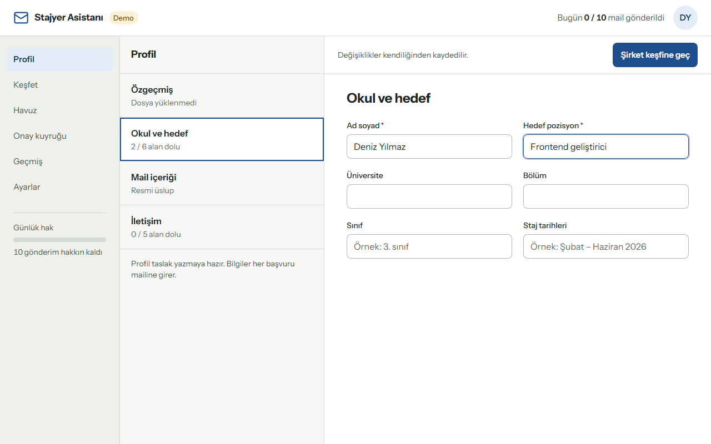
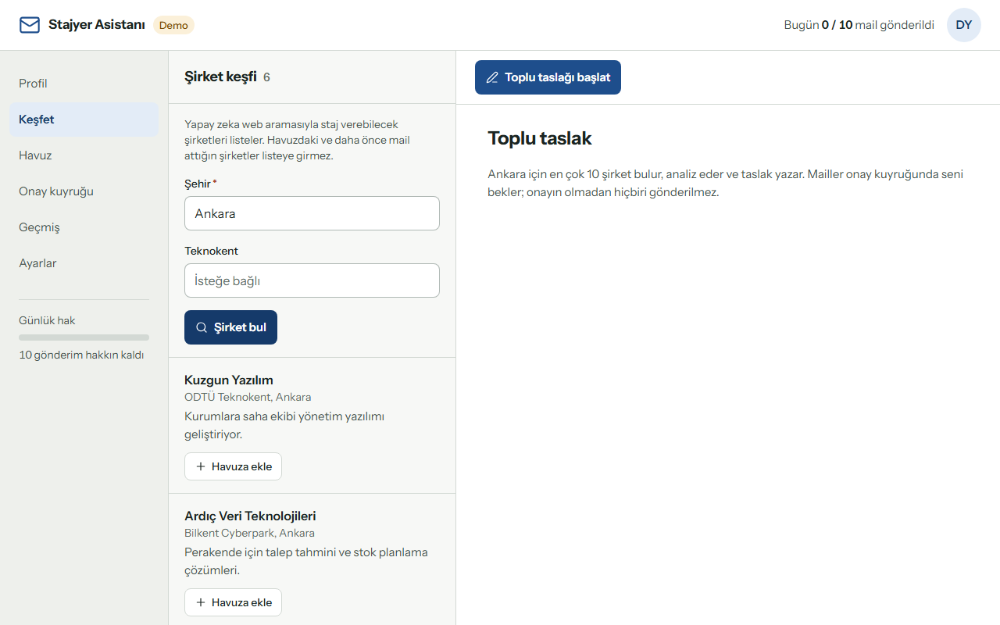
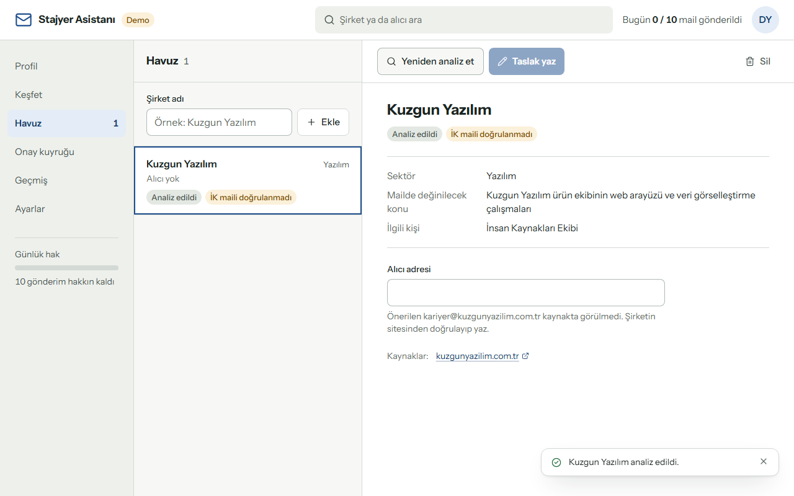
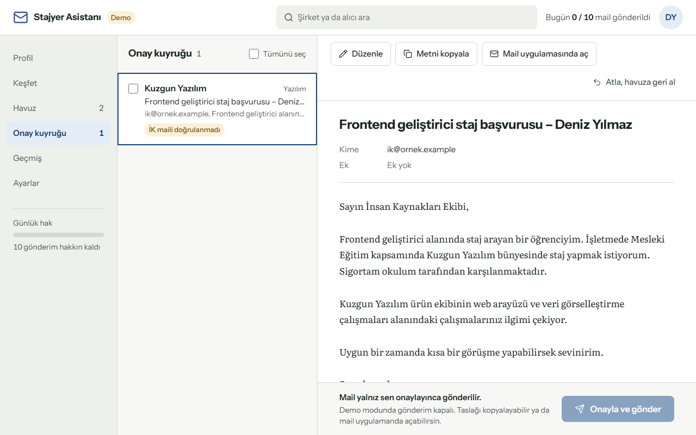
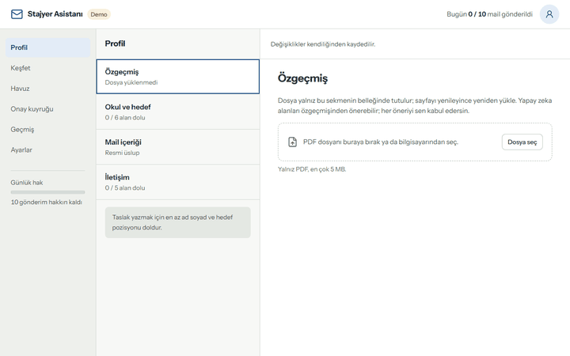

# Stajyer Asistanı

[](https://github.com/rose-omer/stajyer-asistani/actions/workflows/ci.yml)


Staj arayan öğrenci için başvuru asistanı. Şehir ya da teknokentteki şirketleri bulur, her şirketi kaynak göstererek analiz eder ve kişiselleştirilmiş başvuru maili yazar. Mail yalnız kullanıcı okuyup onaylayınca, kullanıcının kendi Gmail hesabından gider.

> GIF: keşif → onay kuyruğu → gönderim (eklenecek).

## Ekran görüntüleri

Görüntüler demo kipinde (VITE_DEMO=1) alındı. Şirketler, kişi adı ve mail taslağı örnek veridir; gönderim kapalıdır.

| | |
|---|---|
| <br>Profil | <br>Şirket keşfi |
| <br>Havuz ve şirket analizi | <br>Onay kuyruğu |

## Kullanım



Profil doldurulur, şirketler bulunur, taslaklar onay kuyruğuna düşer. Hiçbir mail onaysız gitmez.

## Akış

1. **Profil**: PDF özgeçmiş yükle (en çok 5 MB). Yapay zeka alanları önerir; her öneriyi tek tek kabul edersin.
2. **Keşfet**: şehir ve teknokent seç. Sonuçlarda kısa açıklama ve arama kaynakları görünür.
3. **Havuz**: şirketi analiz et. İK adresi kaynak sayfada geçmiyorsa "doğrulanmadı" rozeti çıkar ve adres boş kalır.
4. **Onay kuyruğu**: taslağı oku, düzenle, gönder ya da atla. Toplu gönderimde onay penceresi alıcıları listeler.
5. **Geçmiş**: her gönderim tarihi, durumu ve Gmail bağlantısıyla.

"Toplu taslak" en çok 10 şirket için 1–3. adımları kendisi yapar. Hiçbir mail onaysız gönderilmez.

## Mimari

```
Tarayıcı (React 19, Vite 8, Tailwind 4)
  ├── Supabase Auth (Google ile giriş)
  ├── Supabase Postgres + Storage (RLS: her satır yalnız sahibine açık)
  ├── Supabase Edge Function "gemini" ──> Google Gemini API (anahtar yalnız burada)
  └── Gmail API users.messages.send (kapsam gmail.send, kullanıcının kendi OAuth jetonu)
```

- `supabase/functions/gemini/index.ts`: JWT denetimi, istek şeması, günlük AI kotası, Gemini çağrısı.
- `supabase/functions/_shared/`: şemalar (zod), istemler, İK maili doğrulama. İstemci ve sunucu aynı şemayı kullanır.
- `supabase/migrations/20261120000000_init.sql`: tablolar, RLS, `cv` bucket'ı, kota fonksiyonu.
- `services/`: istemci servisleri (Edge Function çağrısı, MIME iletisi, Gmail, depo).
- `features/`: sayfalar (profil, keşif, havuz, kuyruk, geçmiş, ayarlar) ve toplu taslak.

## Güvenlik

- **Anahtar:** Gemini anahtarı tarayıcı paketine girmez; yalnız Edge Function gizli değişkenindedir. CI, `dist/` içinde `AIza` ve `generativelanguage` dizelerini arar.
- **Oturum:** Edge Function oturumsuz isteğe 401 döner.
- **RLS:** `profiles`, `companies`, `applications`, `usage` tablolarında `user_id = auth.uid()` kuralı var. Testi: `supabase/tests/rls.test.sql`.
- **Onay:** gönderim yalnız onay penceresinden geçer. Toplu taslak modülü gönderim fonksiyonu almaz (birim testiyle denetlenir).
- **Kota:** günlük gönderim sınırı (varsayılan 10, en çok 20; bulutta `reserve_send` fonksiyonu sunucuda da denetler) ve kullanıcı başına günlük AI istek sınırı (`DAILY_AI_LIMIT`, varsayılan 60).
- **Kaynak:** İK adresi yalnız kendi etki alanındaki bir kaynak sayfada geçiyorsa kabul edilir. Sayfa indirme yalnız https, en çok 3 yönlendirme, en çok 500 KB.
- **CORS:** `ALLOWED_ORIGIN` varsayılanı yok; ayar unutulursa uç nokta tarayıcıya kapalı kalır.
- **Kişisel veri:** CV localStorage'a yazılmaz. Giriş yapılınca özel `cv` bucket'ında, yoksa yalnız bellekte tutulur.

## Kurulum

Gerekenler: Node 22 ya da üstü, [Supabase CLI](https://supabase.com/docs/guides/cli), Docker.

```bash
npm ci
cp .env.example .env.local      # değerleri doldur
supabase start
supabase db reset               # şemayı ve RLS'yi kurar
supabase secrets set GEMINI_API_KEY=... ALLOWED_ORIGIN=http://localhost:5173
supabase functions serve gemini
npm run dev                     # http://localhost:5173
```

Supabase değişkenleri boşsa uygulama **demo modunda** açılır: yapay zeka yanıtları sahtedir, gönderim kapalıdır, veri tarayıcıda kalır. Hesapsız denemek için yalnız `npm ci && npm run dev` yeter.

### Ortam değişkenleri

| Yer | Değişken | Açıklama |
|---|---|---|
| İstemci | `VITE_SUPABASE_URL` | Supabase proje adresi |
| İstemci | `VITE_SUPABASE_PUBLISHABLE_KEY` | `sb_publishable_...` anahtarı |
| İstemci | `VITE_GOOGLE_CLIENT_ID` | Gmail gönderimi için OAuth istemci kimliği |
| İstemci | `VITE_DEMO` | `1` ise demo modu |
| Sunucu | `GEMINI_API_KEY` | Gemini anahtarı (`supabase secrets set`) |
| Sunucu | `GEMINI_MODEL` | Varsayılan `gemini-3.5-flash-lite` |
| Sunucu | `DAILY_AI_LIMIT` | Kullanıcı başına günlük AI isteği, varsayılan 60 |
| Sunucu | `ALLOWED_ORIGIN` | **Zorunlu.** CORS kökeni (ör. `https://site.example`). Boşsa tarayıcı istekleri reddedilir. |

### Google Cloud

- OAuth istemci kimliği (Web), yetkili JavaScript kökeni: uygulama adresi.
- Kapsam: `https://www.googleapis.com/auth/gmail.send` (sensitive).
- Uygulama "Testing" modunda kalabilir; test kullanıcısı olarak yalnız kendi hesabını ekle.
- Supabase Auth için Google sağlayıcısını aç (`supabase/config.toml`, `GOOGLE_OAUTH_CLIENT_ID`, `GOOGLE_OAUTH_CLIENT_SECRET`).

## Model ve sürümler

| Bileşen | Sürüm |
|---|---|
| Gemini modeli | `gemini-3.5-flash-lite` (tek kaynak: `supabase/functions/_shared/model.ts`, sunucuda `GEMINI_MODEL` ezer) |
| `@google/genai` (Edge Function) | 3.6.1 |
| React | 19.3.1 |
| Vite | 8.3.8 |
| Tailwind CSS | 4.3.5 |
| TypeScript | 6.0.3 |
| `@supabase/supabase-js` | 2.119.2 |
| zod | 4.6.7 |

`gemini-2.5-flash` 2026-12-01'de kapanır; bu yüzden varsayılan yeni modeldir. Google Search grounding yeni modellerde ücretsiz katmanda kapalı olabilir; keşif ve analiz ücretli katman ister.

## Komutlar

| Komut | İş |
|---|---|
| `npm run dev` | Geliştirme sunucusu |
| `npm run build` | Üretim derlemesi (`dist/`) |
| `npm run typecheck` | `tsc --noEmit` (strict) |
| `npm run lint` | ESLint (typescript-eslint, react-hooks, jsx-a11y) |
| `npm run format:check` | Prettier denetimi |
| `npm test` | Vitest birim ve bileşen testleri |
| `supabase test db` | RLS testleri (pgTAP) |
| `deno check supabase/functions/gemini/index.ts` | Edge Function tip denetimi (Deno) |

## Etik kullanım

Bu araç toplu ve istenmeyen mail için değildir. Her maili oku, alıcıyı doğrula, günlük sınırı düşük tut. KVKK ve 6563 sayılı Kanun kapsamındaki yükümlülükler kullanıcıya aittir.

## Lisans

[MIT](LICENSE)
